# NestPath

A companion app for new parents and the people around them. One family
account holds the baby's **vaccine timeline** from the CDC schedule,
**growth charts** against the WHO standards, a **live shared baby tracker**
(feeds, sleep, diapers) that updates on every caregiver's screen at once,
**appointment booking** with a visit-prep checklist, a **postpartum
check-in** (EPDS) that puts support first, and a **help board** where
friends and family can claim a meal or an errand.

> Portfolio project by Nishtha027. It's a working demo, not a medical
> product: see the [disclaimer](#medical-disclaimer).

| | |
|---|---|
| **Live app** | https://nestpath-one.vercel.app |
| **API docs** | https://nestpath-api.onrender.com/docs |
| **Stack** | Next.js 16, React 19, Tailwind, FastAPI, SQLAlchemy 2, Alembic, Postgres |
| **Hosting** | Vercel (frontend), Render (API), Neon (Postgres), all free tier |

> **The free tier sleeps.** After a quiet spell the first request can take
> up to a minute while the API and the database wake up. The app pings
> both as soon as a page opens and says "NestPath is waking up" while it
> waits. After that it's fast.

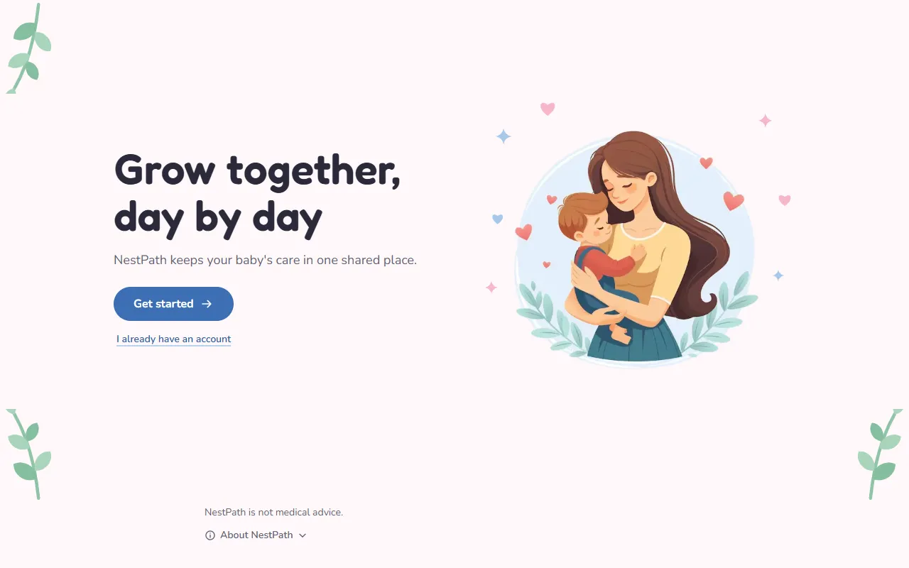

## Contents

- [Screenshots](#screenshots)
- [Features](#features)
- [Architecture](#architecture)
- [Key engineering decisions](#key-engineering-decisions)
- [Tests](#tests)
- [Running locally](#running-locally)
- [Deploying](#deploying)
- [Known limitations](#known-limitations)
- [Medical disclaimer](#medical-disclaimer)
- [Credits](#credits)
- [Care log API](#care-log-api)

## Screenshots

All taken from a local copy running made-up demo data.

| Home | Insights |
|---|---|
| 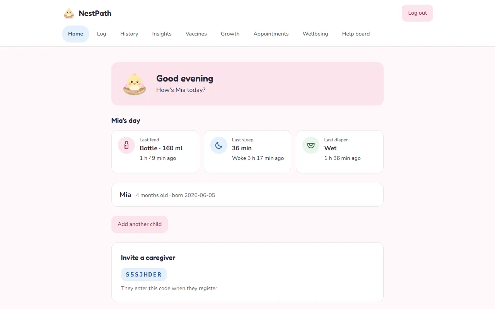 | 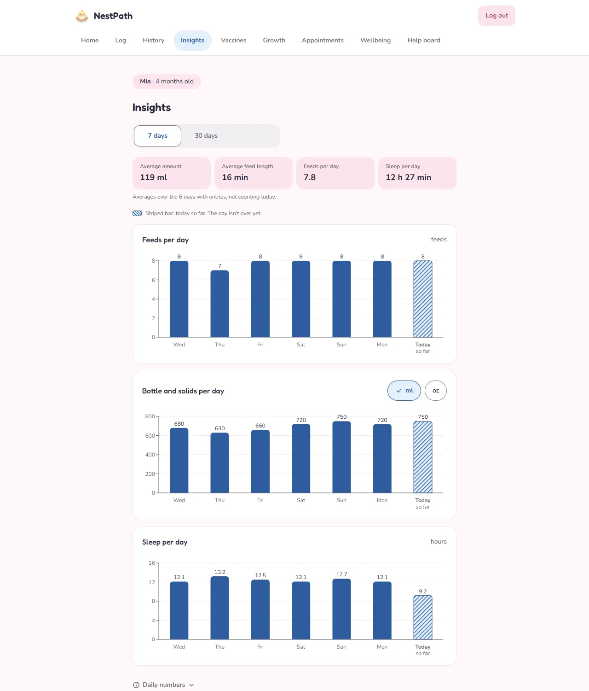 |
| **Vaccines** (overdue dose, closed rotavirus window) | **Growth** (WHO percentile bands) |
| 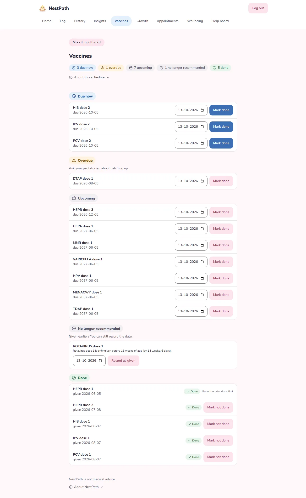 | 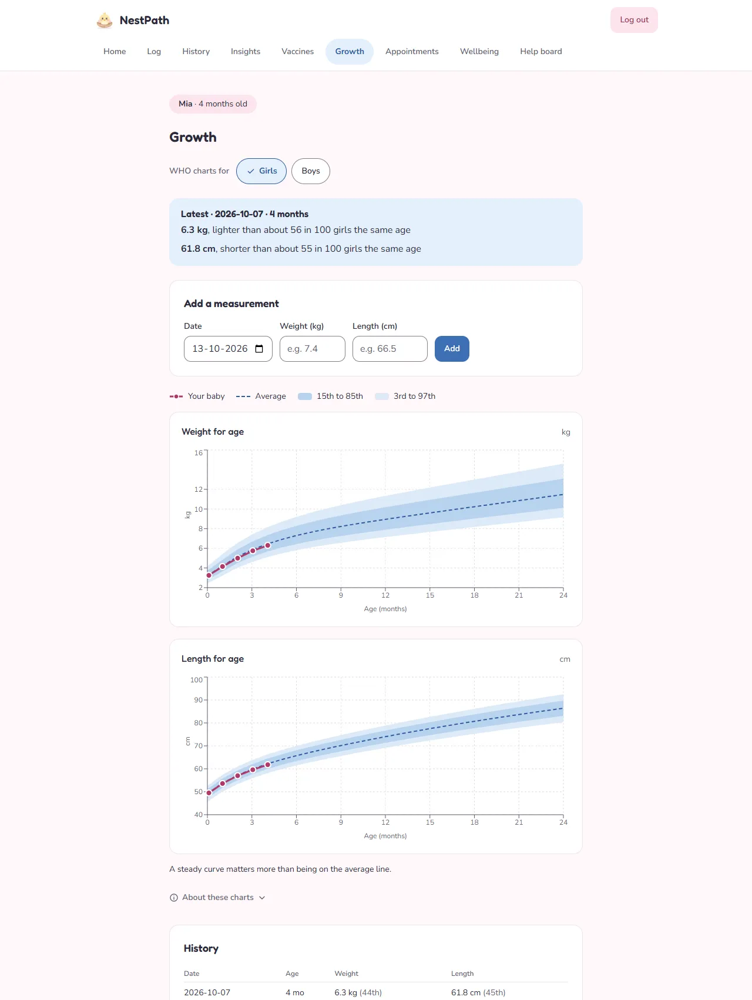 |
| **Check-in result** | **Check-in result with item 10 answered** |
| 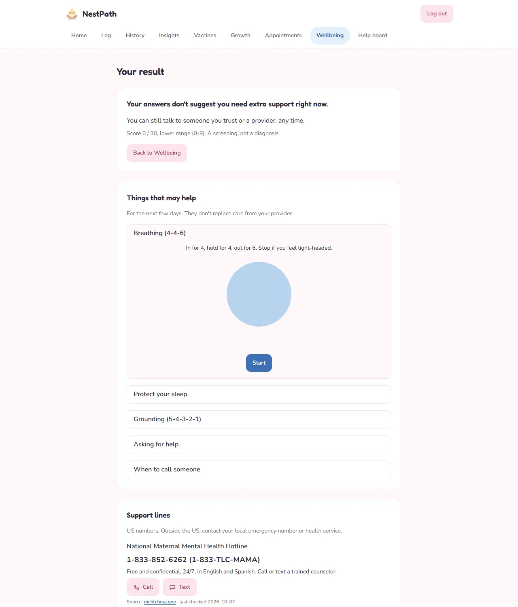 | 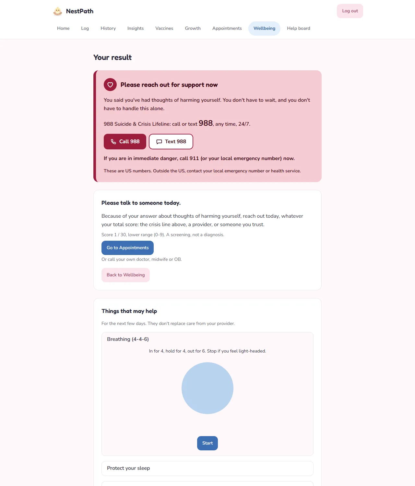 |
| **Appointments** | **Help board** |
| 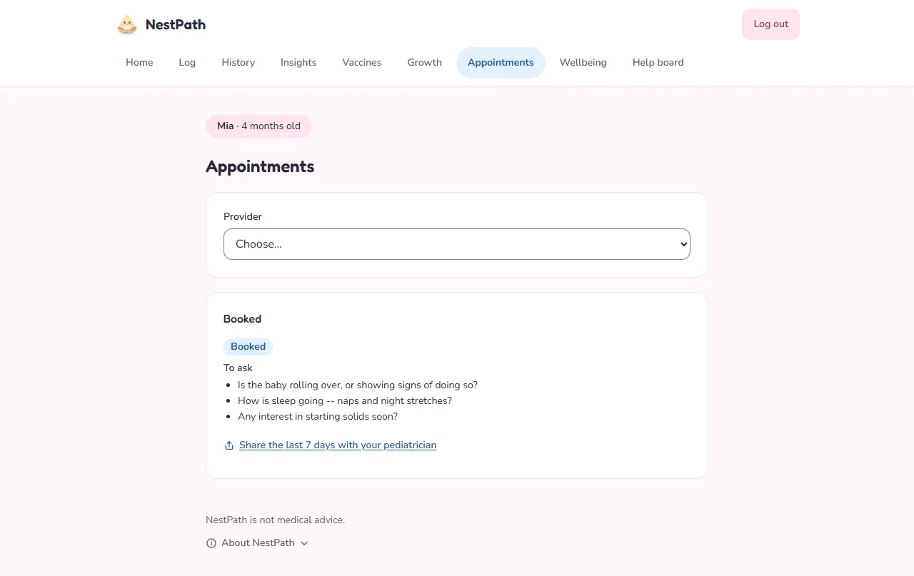 | 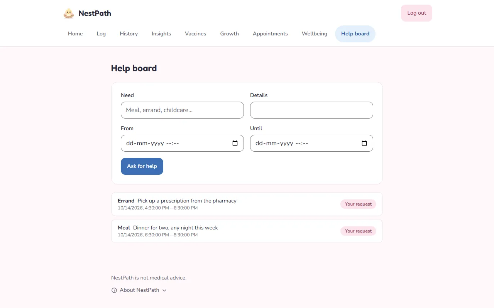 |
| **Provider alerts** | |
| 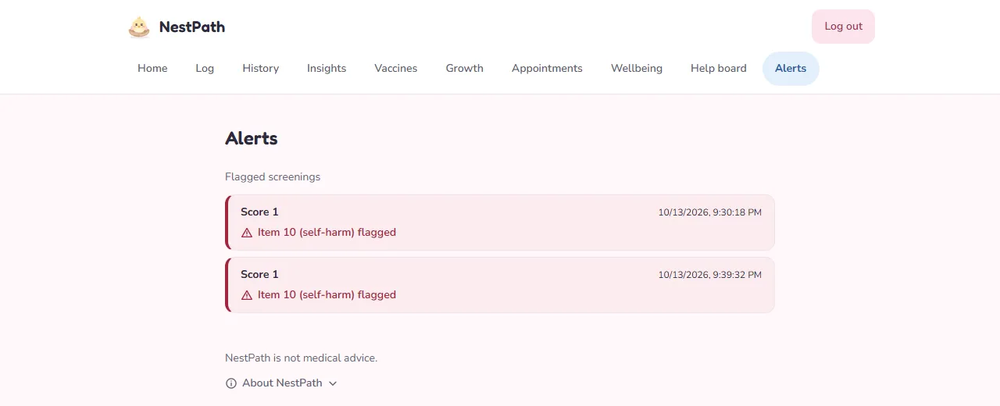 | |

On a phone the app switches to a bottom tab bar:

| Home | Quick log | History |
|---|---|---|
| 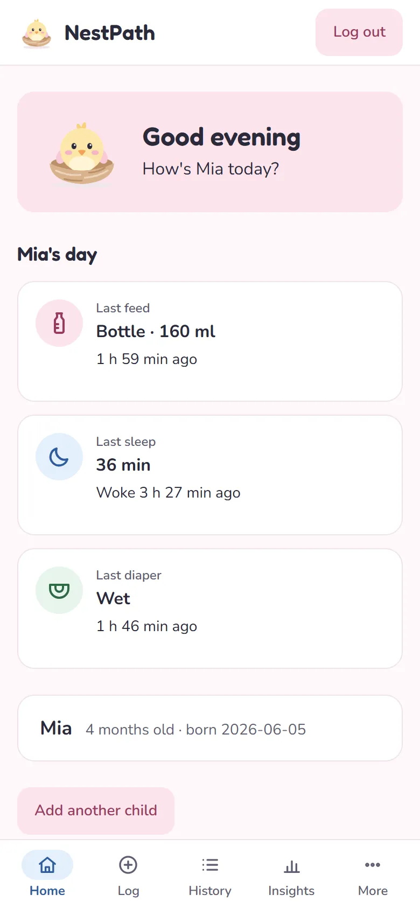 | 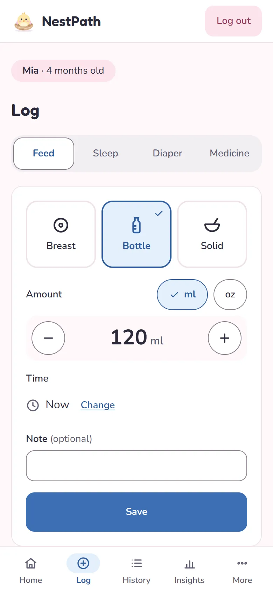 | 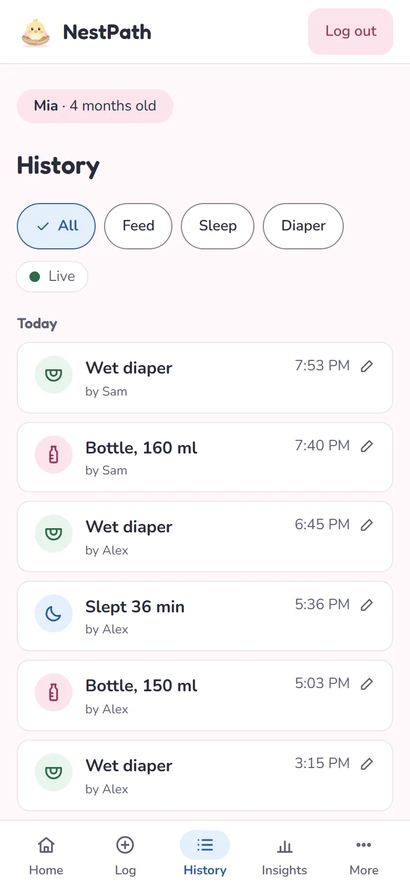 |

## Features

- **Families.** Sign up and start a family, or join one with its invite
  code. Everyone in a family shares the same children, tracker and help
  board; other families' data is never visible.
- **Vaccine timeline** from the CDC child schedule (July 2, 2025 version).
  Doses are due at the *recommended* age, never before the minimum.
  Doses past a hard age limit (for example rotavirus dose 1 after 15
  weeks) show as "No longer recommended at this age" instead of overdue.
  Marking a dose given re-plans the rest of the series from the real date,
  and the latest dose can be undone.
- **Growth.** Weight and length entries get a WHO weight-for-age and
  length-for-age percentile and z-score (0 to 24 months), charted on the
  3rd to 97th percentile bands. Values WHO would call implausible are
  rejected, which catches kg/g and cm/inch mix-ups.
- **Live shared baby tracker.**
  - Log a feed (breast with side, bottle or solids in ml or oz), sleep (a
    start/stop timer or a past nap) or a diaper in a few taps.
  - Every change reaches the other caregivers' open screens at once, with
    who logged it.
  - **History** groups entries by day, with filters, edit and delete.
  - **Insights** charts feeds, amounts and sleep per day over 7 or 30
    days. Today is marked "so far" and left out of the averages.
  - A printable **pediatrician summary** of the last 7 days.
  - Numbers only: it never judges an amount.
- **Appointments.** Providers publish slots; booking is race-safe and
  attaches a visit-prep checklist that matches the baby's age.
- **Postpartum check-in.** The 10-question EPDS with its published
  scoring. Any answer above "Never" on item 10 (self-harm) is treated as
  high risk on the server, whatever the total, and the result page then
  opens with crisis support. Flagged results reach a provider-only
  **Alerts** feed, without names or answers.
- **Help board.** Post a need with a time window; someone else in the
  family claims it. Claims are race-safe, and you can't claim your own.

## Architecture

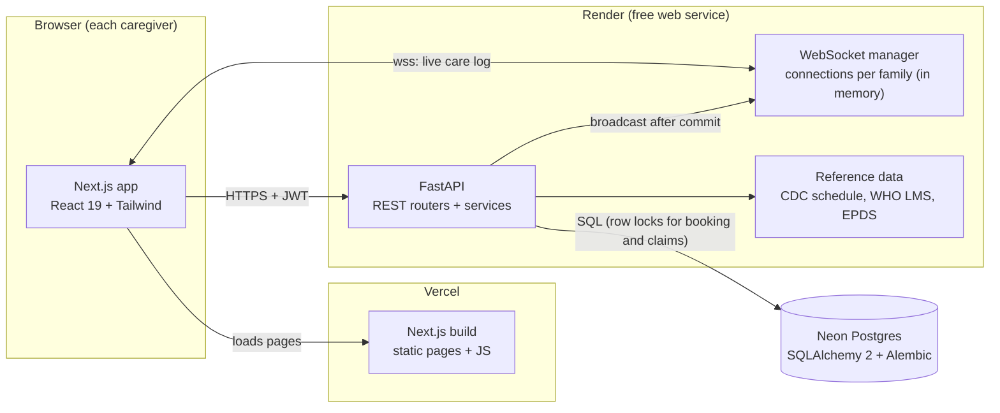

How one tracker entry reaches the other caregiver:

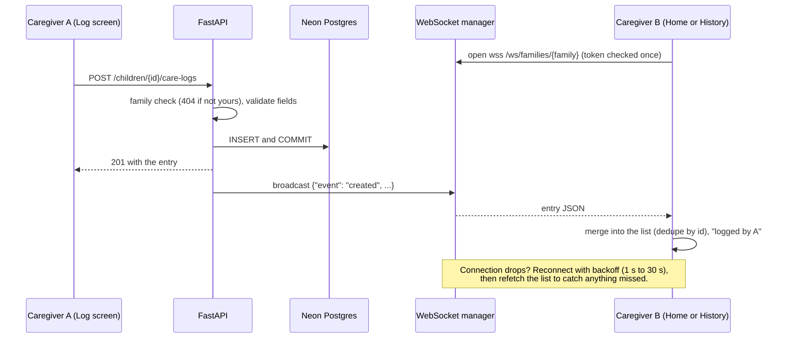

## Key engineering decisions

| Decision | Why |
|---|---|
| **Row locks (`SELECT ... FOR UPDATE`)** for booking a slot and claiming a help request | Two people pressing at the same moment can't both win: the second request waits for the lock, sees the row is taken and gets a 409. Both have concurrency tests. |
| **404, not 403, for another family's data** | One dependency looks up a child and checks the family. Answering "not found" means nobody can probe which IDs exist in other families. |
| **EPDS item 10 is decided on the server** | `risk_level` is "high" whenever item 10 scores above 0, ORed onto the total-score band, so no client and no low total can hide it. The result page orders its sections from that server flag: crisis support first. |
| **Sourced, versioned reference data** | The CDC schedule, WHO LMS tables and EPDS live in `backend/reference-data` with the exact URL, retrieval date and source version. Schedule rows and screening results store the version that produced them. Old schedule rows are regenerated when the encoding changes; given doses are never touched. |
| **WebSocket manager with reconnect and catch-up** | An in-memory registry per family broadcasts after each commit. The client reconnects with exponential backoff (1 s up to 30 s), refetches the list after every connect, and stops on a 1008 (bad token) instead of looping. The socket's database session is closed right after the auth check, so idle sockets don't hold pool connections. |
| **Additive (expand-first) migrations** | New columns are nullable and old rows keep working, so the database can be migrated first, then the API deployed, then the frontend, each on its own. Migration tests run upgrade and downgrade. |
| **Free-tier cold starts handled on purpose** | Every page pings `/health` (server) and `/health/ready` (database) as soon as it opens, requests wait up to 90 s for the wake-up instead of failing, and reads retry only on network errors and 5xx (never 4xx). |

More detail on each, with the trade-offs: [docs/INTERVIEW_NOTES.md](docs/INTERVIEW_NOTES.md).
A 5-minute walkthrough: [docs/DEMO_SCRIPT.md](docs/DEMO_SCRIPT.md).

## Tests

Last full run, 2026-10-13:

| Suite | Result | What it covers |
|---|---|---|
| Backend (pytest, 15 files) | **154 passed** | auth and family scoping, schedule and age windows, growth and plausibility limits, care-log validation, summaries (time zones, DST, midnight splits), concurrent booking and claiming, EPDS scoring with the item-10 rule, migrations up and down, deploy config, demo seed |
| Frontend (node:test, 13 files) | **74 passed** | tracker maths and wording, vaccine grouping, growth helpers, wellbeing result order, retry and wake-up rules, colour contrast, navigation |
| TypeScript, ESLint, `next build` | clean | |

```bash
# Backend: needs a LOCAL Postgres in DATABASE_URL (the suite drops every
# table, and refuses to start unless the host is 127.0.0.1 or localhost).
cd backend
python -m pytest

# Frontend
cd frontend
npm test            # node:test unit tests
npx tsc --noEmit    # types
npm run lint        # eslint
npm run build       # production build
```

## Running locally

You need Python 3.12, Node.js 20 or newer, and Docker (for Postgres).

**1. Postgres** (a throwaway container, reachable only from this machine)

```bash
docker run -d --name nestpath-db -p 127.0.0.1:5432:5432 \
  -e POSTGRES_USER=nestpath -e POSTGRES_DB=nestpath \
  -e POSTGRES_HOST_AUTH_METHOD=trust postgres:16-alpine
```

**2. Backend** (terminal 1)

```bash
cd backend
python -m venv .venv
source .venv/bin/activate          # Windows PowerShell: .venv\Scripts\Activate.ps1
pip install -r requirements.txt
cp .env.example .env               # its DATABASE_URL matches the container above
python -c "import secrets; print(secrets.token_hex(32))"
#   paste the output into .env as JWT_SECRET=...
python -m alembic upgrade head
python scripts/seed_demo_data.py   # demo providers, slots, logins and a week of tracker data
uvicorn app.main:app --reload      # http://localhost:8000, docs at /docs
```

**3. Frontend** (terminal 2)

```bash
cd frontend
npm install
cp .env.example .env.local         # NEXT_PUBLIC_API_URL=http://localhost:8000
npm run dev                        # http://localhost:3000
```

**4. Log in** with the demo parent, `demo-parent@example.com`. Its password
is `LOCAL_PARENT_PASSWORD` in `backend/scripts/seed_demo_data.py`. The demo
provider account that can open Alerts is `demo-provider@example.com`, with
`LOCAL_DEFAULT_PASSWORD` from the same file. Those defaults only work against
a local database; the script refuses to create the demo family anywhere
else and needs a real password for the provider.

To see the live tracker, open the app in two windows, log the second one in
as a new account that joins the demo family with the invite code from Home,
and log a feed in either.

Below 768 px wide the app uses a bottom tab bar (Home, Log, History,
Insights, More); wider screens get top tabs.

## Deploying

Three free-tier services. The order matters because each URL feeds the next.

| Where | Variable | Value |
|---|---|---|
| Render | `DATABASE_URL` | the Neon connection string (the direct, non-pooled one) |
| Render | `JWT_SECRET` | generated by `render.yaml` |
| Render | `CORS_ORIGINS` | the exact Vercel URL, no path |
| Vercel | `NEXT_PUBLIC_API_URL` | the Render URL; the build fails unless it's `https://` |

1. **Database.** Create a Neon project near Render's region.
2. **Migrate and seed** from your machine, with the URL on the command line
   rather than in a file:
   ```bash
   cd backend
   DATABASE_URL='<neon url>' python -m alembic upgrade head
   DATABASE_URL='<neon url>' DEMO_PROVIDER_PASSWORD='<a new secret>' DEMO_SLOT_DAYS=30 \
     python scripts/seed_demo_data.py
   ```
3. **API.** Render > New > Blueprint > this repo, and paste `DATABASE_URL`.
4. **Frontend.** Set `NEXT_PUBLIC_API_URL` in the Vercel project, then
   deploy with the Vercel CLI (below).
5. **CORS.** In Render, set `CORS_ORIGINS` to the Vercel URL. Until then
   the API refuses every browser origin.
6. **Check** with `python scripts/smoke_test_live.py https://<api> --frontend-origin https://<app>`.
   It creates two throwaway accounts and books one demo slot.

**Order for a release with a migration:** migrate Neon, push `main` and wait
for Render to show the deploy as live, then deploy the frontend. Migrations
are additive, so the old code keeps working on the new schema in between.

### Deploying the frontend

> **Warning: run `vercel deploy` ONLY from the `frontend` folder.** Run from
> `backend` or the repo root, it uploads the wrong folder, replaces the live
> site with an empty build (every page 404s) and sends that folder's files to
> Vercel. If that happens, promote the previous deployment in the Vercel
> dashboard, then delete the bad one. The `.vercelignore` files in the root and
> in `backend` keep `.env*` files out of such an upload, but they don't stop
> the deploy itself. Check your prompt ends in `\frontend>` before you run it.

The Vercel project isn't connected to GitHub, so pushing to `main` doesn't
redeploy the frontend:

```powershell
git fetch origin; git status            # on main, level with origin/main, clean
cd frontend
vercel deploy --prod --project nestpath --scope nishtha15 --logs
```

The build uses the project's Production `NEXT_PUBLIC_API_URL`; the local
`.env.local` is never uploaded. The output ends with
`Aliased https://nestpath-one.vercel.app` and the new deployment id.

## Known limitations

- **Cold starts.** The free tier sleeps; the first request after a quiet
  spell can take up to a minute.
- **US only.** The vaccine schedule is the US CDC one, and the support
  lines on the Wellbeing page are US numbers (988 and others).
- **Chronological age only.** Vaccines and growth use age from the birth
  date. There's no corrected age for babies born early.
- **Charts are context, not judgement.** Growth percentiles compare one
  baby with the WHO standard population; tracker charts show only what was
  logged. Neither says whether a number is fine for a given baby.
- **No rate limiting** on invite codes, login or registration. Invite codes
  are 8 characters from a 31-symbol alphabet (about 8.5 x 10^11
  combinations), so guessing is impractical but not impossible.
- **No push notifications.** Live updates reach open screens only.
- **Frontend deploys are manual.** The Vercel project isn't connected to
  GitHub (see [Deploying the frontend](#deploying-the-frontend)).
- **Tokens.** The login token lives in `sessionStorage` (readable by any
  script on the page) and lasts 60 minutes with no refresh token. The
  WebSocket token travels in the URL, because browsers can't set headers on
  a WebSocket handshake. A production app would use an `httpOnly` cookie
  and a short-lived socket ticket.
- **One API instance.** WebSocket connections live in the server's memory;
  several instances would need shared pub/sub such as Redis.

## Medical disclaimer

NestPath is **not medical advice, not a diagnosis and not a crisis
service.** Vaccine dates follow the CDC schedule for healthy children;
growth percentiles and tracker numbers are information to bring to your
pediatrician, not an assessment. The postpartum check-in is a screening
questionnaire (EPDS), not a diagnosis; its result suggests whether to talk
to someone.

**If you or someone else might be in danger, call 911 (US) or your local
emergency number.** In the US you can call or text **988** (Suicide &
Crisis Lifeline) any time. The support lines shown in the app were checked
against each organization's own website on 2026-10-07; they're listed in
`frontend/lib/support-resources.ts` with their source URLs.

## Credits

- **Vaccine schedule:** CDC, *Child and Adolescent Immunization Schedule by
  Age*, catch-up schedule and notes (addendum updated July 2, 2025),
  retrieved 2026-09-18 and re-verified 2026-10-07.
- **Growth standards:** WHO Child Growth Standards (2006); L, M, S values
  from the CDC NCHS "WHO Growth Charts Data Files".
- **EPDS:** Cox, J.L., Holden, J.M. & Sagovsky, R. (1987), *Detection of
  postnatal depression: development of the 10-item Edinburgh Postnatal
  Depression Scale*, British Journal of Psychiatry 150; item text and
  scoring as published by the Black Dog Institute.
- **Fonts:** Fredoka and Nunito (SIL Open Font License), self-hosted at
  build time through `next/font`.
- **Welcome illustration:** `frontend/public/illustrations/hero-mother-child-blue-circle.png`,
  artwork supplied by the project owner. Every other illustration is an
  original SVG drawn for this project.

Exact URLs, retrieval dates and every simplification are in
[`backend/reference-data/README.md`](backend/reference-data/README.md).

## Care log API

Family-scoped like the rest of the API (another family's child or entry is
a 404). `/docs` lists every field.

| Method and path | What it does |
|---|---|
| `POST /children/{id}/care-logs` | Add an entry: `type` (`feed`, `sleep`, `diaper`, `medication`), optional `occurred_at` (default now) and `notes`, plus that type's fields: `feed_type`, `amount_ml` (1-500), `duration_min` (1-180), `side`; `ended_at` or `duration_min`, or `in_progress: true` for a running timer; `diaper_kind`. Another type's fields are a 422; a second running sleep is a 409. |
| `GET /children/{id}/care-logs` | Newest first. `limit`, `offset`, `type`, `from`, `to`. |
| `GET /children/{id}/care-logs/latest` | The newest feed, sleep, diaper and medication. |
| `GET /children/{id}/care-logs/summary?days=7\|30&tz=Area/City` | Per-day totals computed in SQL, by calendar day in the browser's timezone; averages over days with entries, both with today (`averages`) and without it (`averages_excluding_today`). A sleep across midnight is split between the days. |
| `PATCH /children/{id}/care-logs/{entry}` | Change fields (null clears one); stopping a timer is a PATCH with `ended_at`. |
| `DELETE /children/{id}/care-logs/{entry}` | Remove it (204). |
| `WS /ws/families/{family}?token=...` | Live changes: `{"event": "created" \| "updated", ...entry}` or `{"event": "deleted", "id", "deleted_from_child"}`. |

New migrations: change `backend/app/models.py`, then
`python -m alembic revision --autogenerate -m "..."`, **review the file**
(Alembic misses some changes, such as dropping a Postgres enum), and
`python -m alembic upgrade head`.

## License

[MIT](LICENSE)
